  

  <b>Software Engineering Apprentice (Work-Study) – DevSecOps at SNCF Voyageurs | Polytech Lyon</b> 
  Engineering degree in 2027 · Lyon, France

## About

I'm especially interested in **technical cybersecurity, cloud security and DevSecOps**, and in how **AI** can make security and cloud operations smarter, on top of a solid foundation in **data engineering**.

## Right now

- Work-study at SNCF Voyageurs: designing and evolving a business application end to end (requirements analysis, full-stack architecture, application security with RBAC and traceability), with work on hosting and on integrating DevSecOps practices.
- On the side: personal projects around deployment, automation and securing infrastructure (Linux, Docker, VPS).
- I publish my personal and academic projects here, as they are finished.

## What I practice and what I'm learning

| Security | Cloud & infrastructure | Data & AI |
|---|---|---|
| **Practicing** Application security: RBAC, JWT authentication, traceability | **Practicing** Linux, Docker, deployment on a VPS (personal projects) | **Practicing** SQL and PostgreSQL, Python, ETL/ELT concepts, data warehousing (Bronze/Silver/Gold), machine-learning basics (PCA, clustering, supervised models) |
| **Learning** Pentesting, vulnerability analysis, SOC monitoring | **Learning** GitLab CI/CD, Kubernetes, cloud security | **Learning** Airflow, dbt, Spark, MLOps |

**Languages and frameworks:** `Python` `Java` `TypeScript` `JavaScript` `SQL` · `React` `Node.js / Express` `NestJS` `Next.js` · `PostgreSQL` `Prisma` · `Git`

## Where AI meets cloud and security

Areas I'm exploring and building towards:

- **AI-assisted SOC:** triage and prioritization of security alerts
- **Anomaly detection:** machine learning on logs and cloud events
- **DevSecOps for data and ML pipelines:** automated tests, dependency and secret scanning applied to data workflows

I'll publish projects here when they are ready.

## Selected projects

| Project | What it is | Stack |
|---|---|---|
| [VRPTW Metaheuristics](https://github.com/ali-el-bouazzaoui/OptimisationAli-Ayoub) | Vehicle routing with time windows, solved with simulated annealing and tabu search (pair project) | Python |
| [FanfareHub](https://github.com/ali-el-bouazzaoui/FanfareHub) | Web app to manage the members, sections and events of a brass band (team project) | Java, Servlets/JSP, PostgreSQL |

## Get in touch

[LinkedIn](https://www.linkedin.com/in/ali-el-bouazzaoui)
